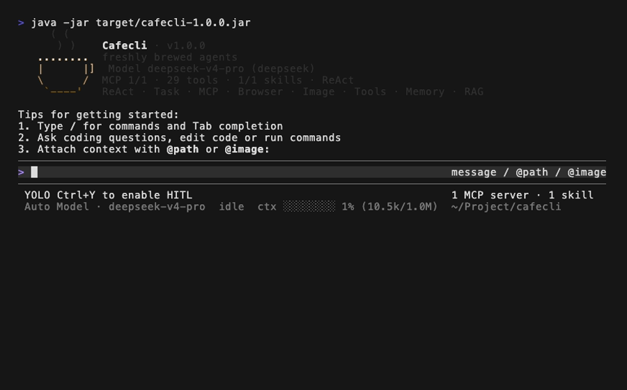
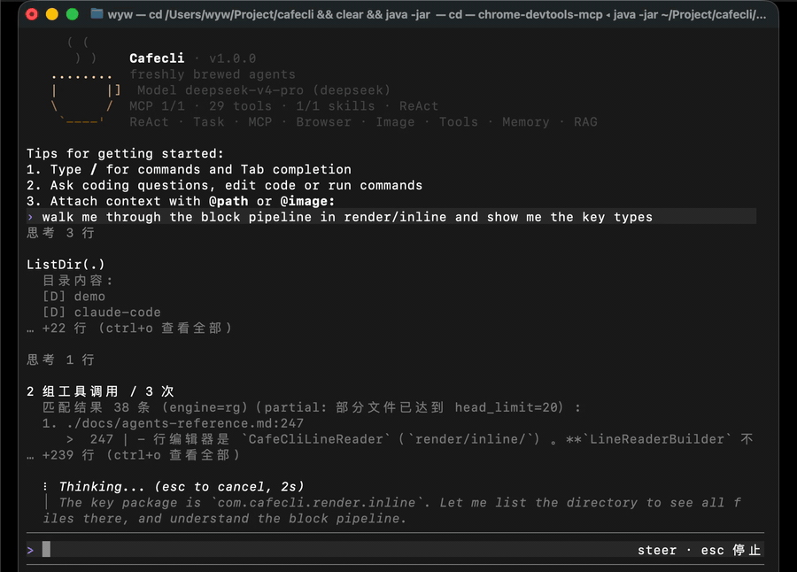

# Cafecli

面向商业使用的 Java Agent CLI —— 在终端里跑的编程助手，对标 Claude Code。

一个 ReAct 循环 + 一套工具 + 一条渲染管线：给它一句任务描述，它自己读代码、改文件、跑命令、看结果，再决定下一步。

| 输入框常驻 · 回合中转向 · 转写浏览层 | 缩放不撕裂 |
|:---:|:---:|
|  |  |
| 模型流式输出时照样能打字；这一行作为**转向消息**注入当前回合，落在它打断答案的位置。`Ctrl+O` 在回合运行中开浏览层，实时跟随；向上翻则停住不被推走，`G` 回到末尾恢复跟随，`ESC` 关层且**不取消回合**。 | 改窗口尺寸时整屏擦掉按新宽度重画，而不是让终端 reflow 出撕裂的历史。摄于真实 Terminal.app——这条性质属于终端模拟器，[ADR 0010](docs/adr/0010-live-region-compositor-on-jline-display.md) 拒绝给出普适保证，所以只在我们声称的那个模拟器里拍。 |

```text
     ( (
      ) )    Cafecli · v1.0.0
   ........  freshly brewed agents
   |      |] Model glm-5.1 (glm)
   \      /  MCP 4/4 · 61 tools · 2/2 skills · ReAct
    `----'   ReAct · Task · MCP · Browser · Image · Tools · Memory · RAG

Tips for getting started:
1. Type / for commands and Tab completion
2. Ask coding questions, edit code or run commands
3. Attach context with @path or @image:
```

## 它能做什么

- **一条执行路径**：所有输入都走 ReAct（思考 → 调工具 → 看结果 → 再思考）。没有第二套编排脚手架需要你挑。
- **12 个内置工具 + MCP 生态**：文件读写与精确编辑、glob / grep 定位、Shell 执行、语义检索、联网搜索与抓取、快照回滚；再加任意 MCP server 动态注入的工具。
- **会话内异步任务**：主 Agent 可以 `spawn_agent` 派生子任务并行推进，前台等结果或后台跑，用 `/task` 查看与干预。
- **常驻输入框的终端 UI**：模型在流式输出时你照样可以打字。折叠的思考 / 工具块进入回卷，`Ctrl+O` 打开全屏转写浏览层看全量历史。
- **权限是分层的，且守卫不可越过**：路径围栏与命令黑名单的拒绝谁都抬不动——用户批准不了，hook 的 `ALLOW` 也豁免不了。
- **多模型**：GLM、DeepSeek、StepFun、Kimi、FreeLLMAPI，`/model` 运行时切换。
- **无人值守入口**：`cafecli run --file issue.md` 同步跑一次，适合 CI、脚本编排与评测。

## 快速开始

### 前置

- **Java 21+**（会话内异步任务跑在虚拟线程上，这是硬要求）
- **Maven**
- 至少一个 API Key：`GLM_API_KEY` / `DEEPSEEK_API_KEY` / `STEP_API_KEY` / `KIMI_API_KEY` / `FREELLMAPI_API_KEY`
- 可选：`ripgrep`（`grep_code` 优先用它，没装会自动回退）；本地 Ollama（RAG 语义检索用，不用 `search_code` 可以不装）

### 安装与运行

```bash
git clone <this-repo> && cd cafecli

cp .env.example .env        # 填入你的 API Key
mvn clean package           # 默认跳过测试，直接产出可用 jar

java -jar target/cafecli-1.0.0.jar
```

也可以走环境变量：

```bash
export GLM_API_KEY=your_api_key_here
# 或
export STEP_API_KEY=your_step_api_key_here
export STEP_MODEL=step-3.5-flash
```

或在 Cafecli 内写入 `~/.cafecli/config.json`：

```text
/config provider freellmapi --base-url http://localhost:5173/v1 --api-key <key> --model auto
/model freellmapi
```

### 无人值守单任务

```bash
java -jar target/cafecli-1.0.0.jar run --file issue.md --trace-file trace.jsonl
```

同步跑一次 `Agent.run`，最终答案写 stdout，NDJSON trace 可选。工具自动放行，但**策略守卫仍然生效**。缺 `--file` 退出码 2，缺 API Key 退出码 1。墙钟超时由外层（如 shell `timeout`）兜底。

## 使用

### 输入

普通文本直接提交给 Agent。`@path` 引用文件，`@image:/abs/path.png` 引用图片，`@server:protocol://path` 引用 MCP resource。输入 `/` 触发命令补全。

模型输出期间键入的字符照常进输入框——它是用户意图的唯一入口，不随回合出现或消失。回合运行中提交的内容作为**转向消息**注入当前回合，落在下一个迭代边界上，而不是排队到下一轮。

### 取消键

一句话规则：**有回合在跑就停回合**，输入框只在没有东西可停时才被清空。

| | 回合运行中 | 空闲、框内有文字 | 空闲、框为空 | 浏览层 / palette 开着 |
|---|---|---|---|---|
| `ESC` | 取消 | 无操作 | 无操作 | 只关闭那一层 |
| `Ctrl+C` | 取消，**框内文字保留** | 清空输入框 | 提示一次，约 2 秒内再按一次退出 | 同左三列，**且不关闭那一层** |
| `Ctrl+D` | 无操作 | 无操作 | 退出 | 无操作 |

「取消」= 取消当前前台回合与仍附着的任务、拒掉正等你回答的审批、丢弃还没生效的转向消息。游离的后台任务不受影响，用 `/task cancel <id>` 单独终止。取消是协作式的：落在回合边界，正在流式吐出的回答不会被从中间截断。

Ctrl+C **不退出 Cafecli**。代价是它不再是卡死进程的逃生口——那时用 `Ctrl+\` 或从另一个终端 `kill`。

### 命令

| 类别 | 命令 |
|---|---|
| 会话 | `/clear`、`/context`（`/ctx`）、`/transcript`、`/exit`（`/quit`） |
| 模型与配置 | `/model <name>`、`/config` |
| 审批与策略 | `/hitl [on\|off]`、`Ctrl+Y` 切换 HITL/YOLO、`/policy`、`/audit [N]`、`/hooks` |
| 记忆 | `/memory [list\|search\|delete\|clear]`（`/mem`）、`/save [--global] <事实>` |
| 检索 | `/index [路径]`、`/search <查询>`、`/graph <类名>` |
| MCP | `/mcp`、`/mcp restart\|logs\|disable\|enable\|resources\|prompts <name>` |
| 浏览器 | `/browser status\|connect [port]\|disconnect\|tabs` |
| Skill | `/skill list\|show\|on\|off\|reload` |
| 快照 | `/snapshot [status\|clean]`、`/restore <N>` |
| 任务 | `/task`、`/task cancel <task_id>`、`/cancel` |

未识别的 `/xxx` 直接报「未知命令」，不会被当成普通输入交给 Agent。

### 工具

| 工具 | 作用 |
|---|---|
| `read_file` | 读文件；裸读 >256KB 报错，改用 `offset` / `limit` |
| `write_file` | 整文件写入（单文件 5MB 上限） |
| `edit_file` | 精确替换；一次调用里的多处 `edits[]` 是**原子**的，全部成功或整体不变 |
| `list_dir` / `glob_files` / `grep_code` | 目录、文件名 glob、代码正则——精确定位的默认三件套 |
| `execute_command` | 项目目录内执行 Shell（默认 60 秒超时、8KB 输出截断、黑名单拦截） |
| `create_project` | 生成 java / python / node 脚手架 |
| `search_code` | RAG 语义检索。**不是精确定位的首选**，关键词不明确或常规搜索无果时才用 |
| `web_search` / `web_fetch` | 联网搜索与正文抓取 |
| `revert_turn` | 回滚到最近第 N 个 pre-turn 快照 |
| `spawn_agent` / `send_message` / `task_output` | 会话内异步子任务 |
| `mcp__{server}__{tool}` | MCP server 动态提供的工具 |

另有 `load_skill`（按需展开 Skill 手册）与 `save_memory`（仅在你明确要求记住时调用）。

同一轮返回的多个工具调用**并行执行**（默认 4 线程），结果按原始顺序回灌。有依赖关系的调用应由模型分多轮发出。

## 架构

### 唯一一条执行路径

ReAct（`agent/Agent.java`），共享 `ToolRegistry` / `MemoryManager` / `SnapshotService`。交互 REPL 是事件循环（`AgentSession` + `cli/InteractiveRepl.java`，`Main` 只做装配）；无人值守走 `run --file`，不引入事件循环。

Plan-and-Execute（`/plan`）与 Multi-Agent 编排（`/team`）**已从树上删除**——它们同属「模型之外的确定性编排脚手架」。需要拆分并行推进时，主 Agent 自己用 `spawn_agent`。`/plan` 现在只打印一句墓碑说明。

### 权限模型：不是沙箱

拦截顺序：`HitlToolRegistry`（含 PreToolUse 路由）→ `ToolRegistry` → `PathGuard` / `CommandGuard`。

- **`PathGuard`**：文件类工具强制限定在项目根内，拦截绝对路径外逃、`..` 穿越、符号链接逃逸
- **`CommandGuard`**：`sudo` / `rm -rf 全盘` / `mkfs` / `dd of=/dev` / fork bomb / `curl|sh` 等的 fast-fail 黑名单
- **HITL**：危险工具的人工审批（批准 / 全部放行 / 拒绝 / 跳过 / 改参数后执行），默认关闭，`/hitl on` 或 `Ctrl+Y` 启用
- **`AuditLog`**：危险工具调用按天写 JSONL 到 `~/.cafecli/audit/`，凭证脱敏

**守卫拒绝是绝对的**：用户批准不了，生命周期 Hook 的 `ALLOW` 也只免除本次 HITL 审批、守卫仍然运行。这是对 Claude Code 的**有意偏离**（其 hook allow 绕过更多权限层）。

**为什么不叫沙箱**：本地 Agent CLI 默认都不做容器 / VM 隔离——沙箱削弱能力、给虚假安全感。生产级 Agent 沙箱实际是 microVM-level（Firecracker / gVisor）。Cafecli 的安全模型是 **HITL + 路径围栏 + 命令快速拒绝 + 审计**，不是隔离。容器 / VM 沙箱在路线图上，尚未交付。

### 终端渲染

默认 inline 形态：主屏直出、不进 alternate screen，完成的输出提交进终端自己的回卷。`CAFECLI_RENDERER=plain` 是纯 println 兜底，`NO_COLOR=1` 禁色保留布局。

两条结构性约束值得单独说，因为它们解释了这里的大部分设计：

- **活区单写者**：终端底部被原地重绘的那片区域（输出尾 + 输入框 + 状态坞）只有一个写者——渲染线程。生产者、模型、任务、输入线程一律只投事件。渲染线程从不读终端。
- **终端按键只有一个消费者**：常驻的 `readLine`。HITL 审批因此经输入框应答（`y` / `n` / `a` + Enter，另有 `s` / `m {json}`）而不是单字符抢读。

缩放走 destructive resize reset：擦可视屏 + 擦保存回卷 + 归位光标，再按有界重画窗口重绘。「算出该擦多远」那条路已被真机实测证伪并整体删除。

### 记忆

- **短期**：当前对话与工具结果，接近预算时自动摘要压缩
- **长期**：**只**经 `/save` 或你明确说「记一下 / 记住」时写入，**不自动提取事实**。只存跨会话稳定事实，默认项目级作用域
- 两道压缩不是一件事：`ContextCompressor` 压短期记忆，`ConversationHistoryCompactor` 压对话历史——后者才是防 window 超限的那道

### 扩展点

| 机制 | 配置位置 | 说明 |
|---|---|---|
| **MCP** | `~/.cafecli/mcp.json`、`.cafecli/mcp.json` | stdio 子进程与 Streamable HTTP server；工具注册为 `mcp__{server}__{tool}`。首次启动自动创建 chrome-devtools 模板 |
| **Skill** | jar 内置 < `~/.cafecli/skills/` < `<project>/.cafecli/skills/` | 每个 Skill 是 `SKILL.md` + `references/` + 可选 `scripts/`；启动只注入 name + description 索引，`load_skill` 才展开正文 |
| **生命周期 Hook** | `~/.cafecli/hooks.json`、`.cafecli/hooks.json` | `PreToolUse` / `PostToolUse` / `Stop` / `UserPromptSubmit`，**四个事件默认全关**，靠系统属性开启。契约对齐 Claude Code（exit 0/2 + JSON 超集） |
| **Prompt 分层** | `~/.cafecli/prompts/`、`.cafecli/prompts/` | 整文件覆盖 `src/main/resources/prompts/` 下的对应层 |

多个 Hook 租户的决定组合取最严：`BLOCK` > `ASK` > `ALLOW` > `CONTINUE`。`BLOCK` 是**模型反馈级**阻断（回灌原因续跑），不是安全拒绝。项目级 hook 配置默认不受信，首次加载需确认，按内容指纹钉住。

### 数据落盘

| 路径 | 内容 |
|---|---|
| `~/.cafecli/config.json` | 默认模型与 provider 配置 |
| `~/.cafecli/memory/` | 长期记忆 |
| `~/.cafecli/rag/codebase.db` | 代码索引（SQLite） |
| `~/.cafecli/snapshots/<project>/<worktree>/.git` | Side-history 快照仓库（不写你项目的 `.git`，ADR 0018） |
| `~/.cafecli/audit/` | 危险工具审计 JSONL |
| `~/.cafecli/logs/cafecli.log` | 调试日志（按天数与容量滚动清理） |
| `~/.cafecli/history/session_*.jsonl` | 对话历史 |

配置读取优先 `~/.cafecli` / `.cafecli` / `CAFECLI_*` / `-Dcafecli.*`；旧的 `paicli` 形式仅作兼容回退。

## 技术栈

Java 21 · Maven · OkHttp · Jackson · JLine 4 · SQLite · JavaParser · Ollama（本地 Embedding）

## 测试

```bash
mvn clean package                            # 默认跳过测试，优先产出可手工验收 jar
mvn test -Pquick                             # 常规回归
mvn test -Pphase16-smoke                     # inline 渲染冒烟
mvn test -Dtest=XxxTest -DskipTests=false    # 针对性（注意 -DskipTests=false）
mvn test -DskipTests=false                   # 全量
```

渲染侧的屏幕真相判据不在 `phase16-smoke` 里，要按名字单独跑：`ScreenTruthRegressionTest` / `InputBoxLiveRegionTest` / `ToolCallBlockTest` / `CaptureDisplayInterceptionGuardTest` / `HardTerminationCouplingTest`。

## 文档

| 想知道什么 | 去哪 |
|---|---|
| 术语的准确含义（活区 / 冻结回卷 / 工具块 / 取消键 / 策略守卫 / 任务…） | [`CONTEXT.md`](CONTEXT.md) |
| 某个决策**为什么**是现在这样、否决过什么 | [`docs/adr/`](docs/adr/) |
| 配置项、读取顺序、环境变量、单模块行为细节 | [`docs/agents-reference.md`](docs/agents-reference.md) |
| 给 agent 协作者的首读入口与不变式 | [`AGENTS.md`](AGENTS.md) |
| 演进历程与路线图（**代表方向，不代表已交付**） | [`ROADMAP.md`](ROADMAP.md) |

## 已知边界

- **已被旧版本劫持的 `.git` 需要你手工修**（ADR 0018）。v1.0.0 之前的快照服务会覆盖 linked worktree / submodule 的 `.git`（即 `.git` 是 gitfile 而非目录的项目根），此后该目录下的 git 操作全部解析到快照仓库——**静默改写历史归属，不报错**。现在这条 bug 已修复，且 Cafecli 启动时会检测出被咬过的目录、停用快照并打印指引；但**它不会自动改写你的 `.git`**——修复要在主仓库那侧发起：`cd <主仓库> && git worktree repair <被劫持的目录>`。普通仓库（`.git` 是目录）从来不受影响
- 路线图上未交付：容器 / VM 沙箱、MCP OAuth + sampling + server 自动重启
- 不做视频 / 音频输入、图像生成、终端内 sixel 图片预览
- SPA / 防爬墙站点的 `web_fetch` 会返回空正文并提示走浏览器 MCP 路线

## 致谢

Cafecli 基于 [itwanger/PaiCLI-Python](https://github.com/itwanger/PaiCLI-Python)（作者 [沉默王二](https://github.com/itwanger)，MIT License）的思路用 Java 重新实现并大幅扩展。上游项目的版权声明按 MIT 条款保留在 [`LICENSE`](LICENSE) 中。

## 许可

[MIT](LICENSE)
